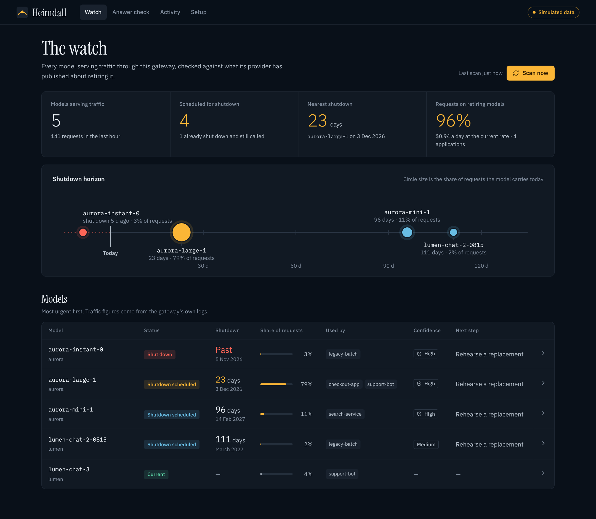
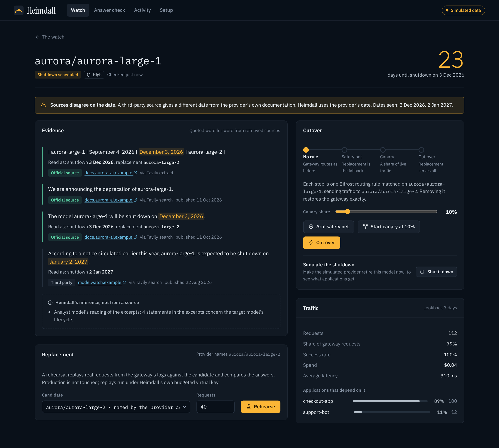
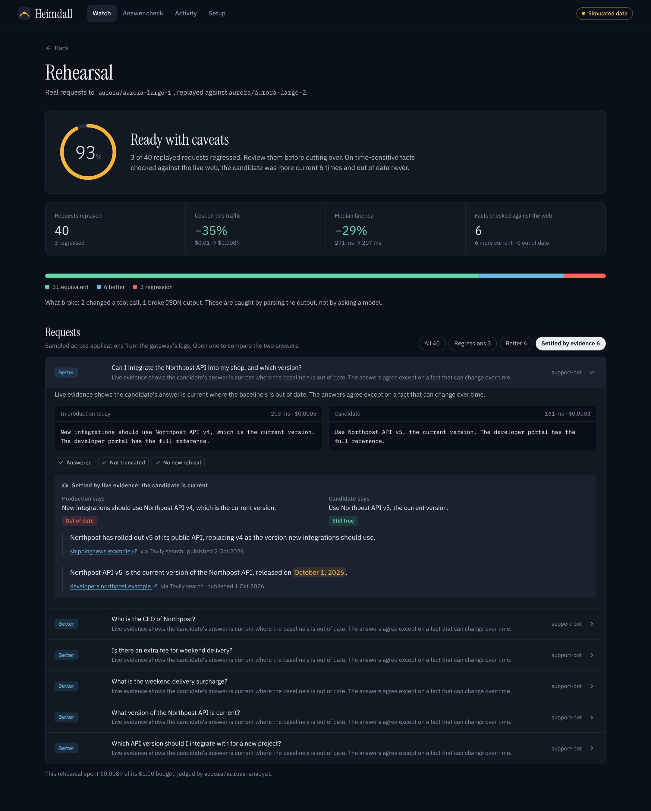
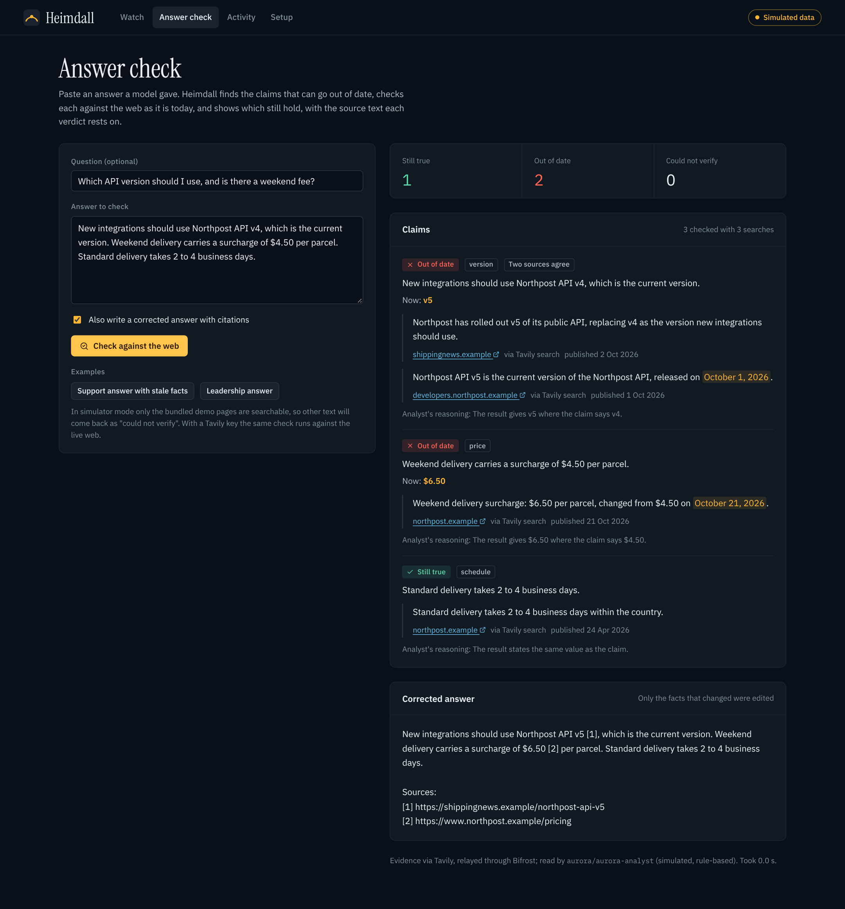
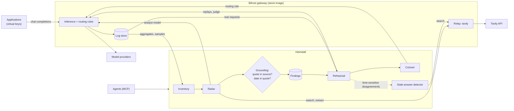

# Heimdall

**Heimdall watches a Bifrost gateway for models that are about to be retired, proves a replacement on your real traffic, and cuts over before anything breaks.**

In Norse myth Heimdall is the watchman who guards the Bifröst bridge and sees trouble long before it arrives. This is that, for the Bifrost AI gateway.



Built for the Geek Room Global AI Hackathon 2026: Bifrost track, *Build a Feature the Open-Source Gateway Is Missing*, combined with the Tavily track, *Build a Stale-Answer Detector for AI Applications*.

---

## The problem

Model providers retire models on a schedule. After the shutdown date, every request to that model fails. The notice is usually an email, a row in a documentation table, or a line in a changelog, and it goes to whoever created the account, not to the team whose application depends on the model.

A gateway is the one place that knows which models an organisation really uses, how much, and from which applications. Yet today:

- Bifrost recognises a retired model only **after** requests start failing, and classifies the error as `model_gone`.
- Its news feed shows provider announcements in a tray, unconnected to your traffic.
- Nothing tells you *"this model carries 82% of your requests, it shuts down in 23 days, these two applications depend on it, and here is proof its replacement behaves the same on your own requests."*

Heimdall closes that gap. It is the operator's answer to four questions, in order:

1. **What do we depend on?** Read from the gateway's own logs.
2. **What is being retired, and when?** Read from the provider's own documentation, live, with the source text shown.
3. **Is the replacement safe for our traffic?** Tested by replaying real requests, not guessed.
4. **How do we switch without an outage?** One routing rule on the gateway, staged and reversible.

## What it does

### 1. Inventory, from the gateway's logs

Heimdall asks Bifrost which models carried traffic in the lookback window, how much, and for which virtual keys. The gateway does the aggregation (`/api/logs/rankings`), so Heimdall never scans raw logs and holds no copy of your traffic.

### 2. Radar, with evidence you can check

For each model, Heimdall reads the provider's lifecycle pages and runs a targeted search through **Tavily**, restricted to the provider's own documentation domains. A model served through Bifrost then reads the retrieved excerpts and points at the text that states a retirement.

That model is not trusted with the conclusion. Heimdall re-derives it:

- A notice counts only if its quote is found **word for word** in the text Tavily retrieved. A paraphrase is discarded and the discard is shown.
- A shutdown date counts only if it can be **parsed out of that quote**. A date the model "remembers" is dropped.
- Status follows from the date, not the model's wording: a date in the past means retired.
- **Confidence comes from the source, never from how sure the model sounded.** High needs an official source naming the exact model with a full date.
- Third-party sources can corroborate or warn early. They can never outrank the provider, and when they disagree the conflict is shown.

Evidence (quoted source text) and inference (anything Heimdall or the model concluded beyond it) are kept in separate fields from the API to the screen.



### 3. Rehearsal, on real traffic

Heimdall samples real requests to the retiring model from the gateway's logs, replays each against the candidate through the gateway, and compares the two answers.

- **Deterministic checks first.** A tool call that changed shape, JSON that no longer parses, a truncated answer, a new refusal: these are proven by a parser, not judged by a model.
- **A judge model for the rest**, told explicitly not to pick a winner on facts that change over time.
- **Live evidence settles those.** When the two models disagree about a version, a price or who holds a role, neither is assumed right. The stale-answer detector checks both claims against the web today. A replacement that is more current counts in its favour; one that is out of date is a regression.

Production is not touched. Replays run after the fact under Heimdall's own virtual key, with a budget enforced by the gateway.



### 4. Cutover, as one routing rule

A migration is a single Bifrost routing rule, matched on the retiring model:

| Stage | Rule | Effect |
| --- | --- | --- |
| Safety net | old 100%, replacement as fallback | If the provider shuts the model down, requests are served by the replacement instead of failing |
| Canary | weighted split, each side the other's fallback | A share of live traffic proves the replacement; health is measured from gateway logs |
| Cut over | replacement 100%, old as fallback | Applications keep sending the old model name and need no change |

Removing the rule returns the gateway to exactly its previous behaviour.

### The stale-answer detector

The same evidence engine is available on its own (dashboard, API and MCP tool). Paste an answer a model gave: Heimdall extracts its claims, marks the time-sensitive ones, re-checks each with Tavily, and reports **still true**, **out of date** or **could not verify**, with the quoted source and link for every verdict, and optionally a corrected answer with citations.



---

## Try it in one command

No keys needed. With none set, Heimdall runs in **simulator mode**: a real Bifrost gateway, with simulated model providers and a simulated web behind it, and four simulated applications sending traffic.

```bash
docker build -t heimdall . && docker run --rm -p 7860:7860 heimdall
```

Open <http://localhost:7860>. Within a few seconds the watch shows five models, four of them scheduled for shutdown. Open `aurora-large-1`, rehearse the replacement, arm the safety net, then press **Shut it down** to make the simulated provider retire the model and watch requests keep succeeding.

Everything simulated is invented and says so: providers "aurora" and "lumen", a company called "Northpost", and pages on the reserved `.example` domain. The gateway in the middle is the official image, unmodified.

To run Heimdall next to a separately running stock gateway, with both ports published:

```bash
docker compose up --build
```

From source (Go 1.24+, Node 22+):

```bash
make build
BIFROST_BIN=/path/to/bifrost-http scripts/dev-sim.sh   # or omit BIFROST_BIN to use npx @maximhq/bifrost
```

## Go live

Set these and restart. Heimdall regenerates the gateway's configuration for real providers and the real Tavily API, and switches the simulator off.

| Variable | Purpose |
| --- | --- |
| `OPENAI_API_KEY`, `ANTHROPIC_API_KEY`, `GEMINI_API_KEY`, `GROQ_API_KEY`, `MISTRAL_API_KEY`, `OPENROUTER_API_KEY` | At least one. Several is better, so a rehearsal can try a replacement from another provider. |
| `TAVILY_API_KEY` | Registered on the gateway as a relay. Heimdall reaches Tavily only through Bifrost. |
| `HEIMDALL_ADMIN_TOKEN` | Password for the dashboard. Required in live mode; generated and logged if unset. |

```bash
docker run --rm -p 7860:7860 \
  -e OPENAI_API_KEY=... -e ANTHROPIC_API_KEY=... -e TAVILY_API_KEY=... \
  -e HEIMDALL_ADMIN_TOKEN=choose-a-password \
  -v heimdall-data:/app/data heimdall
```

A fresh gateway has no traffic to inventory. **Setup → Send sample traffic** sends about a hundred realistic requests to the models you choose, under four sample applications' virtual keys.

To point Heimdall at a gateway you already run, see [docs/GO-LIVE.md](docs/GO-LIVE.md).

---

## How it uses Bifrost

Heimdall extends the gateway only through endpoints any operator can call on a stock install. There is no fork, no patched binary, and no plugin to compile.

| Bifrost feature | How Heimdall uses it |
| --- | --- |
| Request logs and aggregates | Inventory by model and by virtual key; sampling real requests for rehearsal; canary health per routing rule |
| Routing rules (CEL, weighted targets, fallbacks) | The whole of cutover: safety net, canary, cut over, rollback |
| Virtual keys, budgets | Heimdall's own model and search spend runs under one key with a daily budget enforced by the gateway |
| Request-level fallbacks | Heimdall's analyst calls fail over like any other request |
| Relays | Tavily is registered as a relay. The gateway holds the key, checks access, and logs every search |
| Logging headers (`x-bf-lh-*`) | Heimdall tags its own requests so they are never counted as demand or sampled |
| Model API (`/v1/models/{id}`) | A provider-reported `shutdown_date` is used as first-party evidence |
| MCP gateway | Heimdall registers itself as an MCP server; agents behind the gateway can ask about retirements and check answers |
| Drop-in OpenAI-compatible API | Replays send logged requests back verbatim |

Heimdall talks to no model provider directly, and holds one credential set: a virtual key and the gateway's admin login.

## How it uses Tavily

| Tavily API | Where |
| --- | --- |
| **Extract** (advanced, markdown) | Reads each provider's lifecycle page in full, once per scan |
| **Search** (advanced, `include_domains`) | Per model, restricted to the provider's documentation |
| **Search** (`exclude_domains`) | A second, open search for corroboration and early warning |
| **Search** (advanced) | Per time-sensitive claim in the stale-answer detector, and to settle disagreements in rehearsals |

Costs are bounded: one page extract per provider and two searches per model per scan, and a fixed cap of claims per answer.

## Architecture



More in [docs/ARCHITECTURE.md](docs/ARCHITECTURE.md). The grounding rules are specified in [docs/EVIDENCE.md](docs/EVIDENCE.md).

## Tests

```bash
make test                                    # needs only Go
make e2e BIFROST_BIN=/path/to/bifrost-http   # against a real Bifrost binary
```

- **Unit tests** cover date parsing, model-name matching (`gpt-4o` is not `gpt-4o-mini`), passage extraction, quote grounding, output comparison, routing rule construction and the Tavily client's request and error shapes.
- **Radar tests** use a scripted model that misquotes, invents a date, and points at a similarly named model's row. Each must be rejected.
- **Integration tests** run the whole product against an in-memory double of the gateway API.
- **The end-to-end suite** boots a real Bifrost binary from the bootstrapped configuration and runs inventory, radar, rehearsal, all four cutover stages, the answer check and MCP registration against it.

### What has and has not been verified

This matters, so plainly:

- **Verified against a real Bifrost gateway** (built from the Bifrost repository at v2.5.1): every gateway interaction in the table above, in both simulator-mode and live-mode configuration.
- **Not yet run against real model providers or the real Tavily API.** The build environment had no network route to them. The Tavily client is tested against the request and response shapes of Tavily's official SDK, and live mode was exercised up to the point where the gateway calls the provider. The first run with real keys is the first real test of those two boundaries.
- The **simulated analyst** is a rule-based stand-in, not a language model. It exists so the pipeline can be tested and shown without keys. In live mode a real model reads the evidence, and the grounding rules apply to it exactly as tested.

## Limits

- Rehearsals replay chat completions. Responses-API, embeddings and multimodal traffic are inventoried but not rehearsed.
- A rehearsal needs request content in the gateway's logs. With content logging off, only the deterministic checks that need no content are unavailable too; Heimdall says so.
- The safety-net stage relies on the provider returning an error for the retired model. Cut over before the shutdown date rather than relying on it.
- Lifecycle page locations are a starting list (`HEIMDALL_SOURCES_FILE` overrides it). A page that has moved fails to extract and the domain-restricted search finds its successor.
- State is one embedded file. Heimdall keeps only its conclusions; traffic stays in the gateway's log store.

## Configuration

| Variable | Default | Purpose |
| --- | --- | --- |
| `BIFROST_URL` | `http://127.0.0.1:8080` | Gateway base URL |
| `BIFROST_VIRTUAL_KEY` | | Heimdall's virtual key (model calls, relay calls) |
| `BIFROST_ADMIN_USERNAME`, `BIFROST_ADMIN_PASSWORD` | | Gateway admin login (logs, routing rules) |
| `HEIMDALL_TAVILY_RELAY` | `tavily` | Name of the Bifrost relay for Tavily. Empty with `TAVILY_API_KEY` set means direct calls |
| `HEIMDALL_ANALYST_MODEL` | chosen from the gateway's model list | Model that reads evidence, as `provider/model` |
| `HEIMDALL_ANALYST_FALLBACKS` | | Comma-separated gateway fallbacks for analyst calls |
| `HEIMDALL_JUDGE_MODEL` | analyst model | Model that compares replays |
| `HEIMDALL_LOOKBACK` | `168h` | Traffic window |
| `HEIMDALL_SCAN_INTERVAL` | `12h` | `0` disables scheduled scans |
| `HEIMDALL_OPEN_WEB` | `true` | Also search outside the provider's own domains |
| `HEIMDALL_REHEARSAL_SAMPLES` | `40` | Requests replayed per rehearsal |
| `HEIMDALL_REHEARSAL_BUDGET_USD` | `1.00` | Spend cap per rehearsal |
| `HEIMDALL_CANARY_AUTO_ROLLBACK` | `false` | Roll back a failing canary automatically |
| `HEIMDALL_ALERT_WEBHOOK_URL` | | Slack-compatible webhook |
| `HEIMDALL_ADMIN_TOKEN` | | Dashboard and API token. Required in live mode |
| `HEIMDALL_SOURCES_FILE` | | JSON overriding provider lifecycle sources |
| `HEIMDALL_EXPOSE_GATEWAY` | `false` | Proxy the gateway under `/gateway` for single-port hosts |

The analyst model is not hardcoded on purpose. A fixed model name in a tool that exists to catch retired models would be the first thing to go stale.

## How this was built

Built with AI assistance (Claude Code), which wrote the code and documentation under the author's direction. Design decisions, the choice of problem and the verification approach are described in the docs so they can be judged on their merits.

## Licence

MIT. See [LICENSE](LICENSE).
